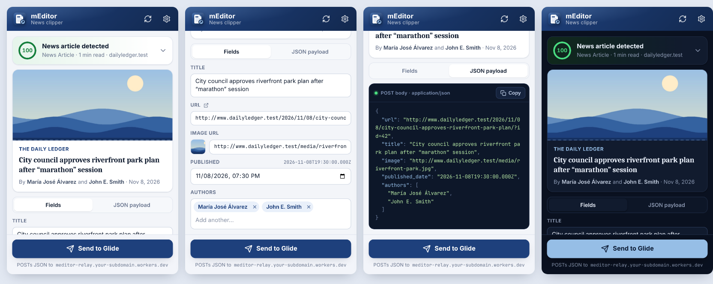

# mEditor — News Clipper

A Chrome extension that recognizes when you're reading a news article, pulls out its key details, and sends them to a Glide webhook in one click.



## What it sends

Each clip is a `POST` with `Content-Type: application/json` and exactly this shape:

```json
{
  "url": "https://www.example.com/2026/11/08/city-council-approves-riverfront-park-plan/",
  "title": "City council approves riverfront park plan after “marathon” session",
  "image": "https://www.example.com/media/riverfront-park.jpg",
  "published_date": "2026-11-08T19:30:00.000Z",
  "authors": ["María José Álvarez", "John E. Smith"]
}
```

| Field | Value |
| --- | --- |
| `url` | The page's canonical URL, with tracking parameters (`utm_*`, `fbclid`, `gclid`, …) and `#fragments` removed. |
| `title` | The article headline, with the trailing “– Site Name” removed. |
| `image` | The absolute URL of the lead image. |
| `published_date` | ISO 8601 in UTC, or `""` if the page has no date. |
| `authors` | Each author as a separate string, with “By …” and the publisher name removed. Empty array if none found. |

## How clips reach Glide

```
mEditor extension ──POST clip──▶ mEditor relay (Cloudflare Worker) ──+ bearer token──▶ Glide webhook trigger
```

The Glide webhook trigger requires a bearer token. Anything shipped inside an extension can be read by its users, for example in DevTools' Network tab. So the token and the Glide URL live only in a small **relay** ([`relay/`](relay/)), stored as Cloudflare secrets.

The extension only knows the relay's address. The relay checks each clip and adds the `Authorization` header before forwarding it. Users never see the token, and rotating it never requires an extension update. See [relay/README.md](relay/README.md) to deploy it (about 5 minutes, free plan).

## Install

1. **Deploy the relay** once (see [relay/README.md](relay/README.md)). Note its URL, e.g. `https://meditor-relay.<you>.workers.dev/`.
2. **Build the extension with that URL as its default:**
   ```bash
   echo 'https://meditor-relay.<you>.workers.dev/' > .webhook-url   # gitignored
   npm run package      # → dist/meditor-extension-v1.3.1.zip
   ```
   The packager refuses to bake in a raw `glideapps.com` URL, because users would then need the token.
3. **Publish it** to the Chrome Web Store as an unlisted item (see [Publishing](#publishing-to-the-chrome-web-store)), and share the store link. Or **install the zip directly** on each computer:
   1. Unzip it.
   2. Open `chrome://extensions` and switch on **Developer mode**.
   3. Click **Load unpacked** and pick the folder.
   4. Pin mEditor from the puzzle-piece menu.

If a build has no default URL, Settings opens on install and asks for the relay URL.

**Updating:** unzip the new build over the same folder, then click ↻ on mEditor's card in `chrome://extensions`. Settings and history are kept. Installs from v1.1 or earlier that stored the Glide URL directly are switched to the relay automatically, and any saved token is deleted.

Works in Chrome 110+ and other Chromium browsers (Edge, Brave, Arc).

## Using it

- **Click the icon** (or press <kbd>Alt</kbd>+<kbd>Shift</kbd>+<kbd>N</kbd>) on any article to see the detection score, a preview card and every field. mEditor reads a page only when you do this, unless you turn on automatic detection.
- **The toolbar badge** shows the result. <kbd>✓</kbd> green means a news article, <kbd>?</kbd> amber means it might be one, and <kbd>↑</kbd> navy means you already sent this page. With **Automatic detection** on, the badge appears as you browse, without clicking.
- **Fix anything before sending.** Title, URL, image, date and author chips are all editable, and the *JSON payload* tab shows exactly what will be posted.
- **Click Send to Glide** (or press <kbd>Ctrl</kbd>/<kbd>⌘</kbd>+<kbd>Enter</kbd>). The button turns green when the webhook accepts the clip. If it fails, it turns red and shows the reason.
- On pages that don't look like articles, the button becomes **Send anyway**. Detection guides you but never blocks you.

### Settings

Right-click the icon and choose **Options**, or click the gear in the popup.

- **Webhook URL**: where clips go (normally the relay). You can send a test payload, or reset to the build's default. Saving a URL on another host asks Chrome for permission to contact that host only.
- **Automatic detection** (off by default): shows the badge on articles as you browse. Turning it on asks Chrome for access to all sites; turning it off gives that access back. Detection runs locally and sends nothing.
- **Auto-send** (off by default; needs automatic detection): sends articles as soon as you open them if their score meets your minimum confidence (default 70%). Each URL is sent only once.
- **Recent clips**: the last 100 sends with status, kept only in this browser.

## How detection works

The content script scores each page from signals it finds:

| Signal | Effect |
| --- | --- |
| Schema.org `NewsArticle` family (JSON-LD or microdata) | strong + |
| Schema.org `Article` / `BlogPosting` | + |
| `og:type = article`, `article:*` meta tags | + |
| Publish date, byline, `<article>` with headline and timestamp | + |
| Substantial body text (paragraph word count) | + |
| Dated or headline-style URL, known news publisher | small + |
| Homepage, section front, tag/category index, product/video/profile pages | − |
| Reference and social sites (Wikipedia, GitHub, YouTube, …) | − |

A score of 55 or more counts as an **article**, 30–54 as **maybe**, and anything lower as **not an article**. Expand the verdict in the popup to see which signals fired.

Each field is extracted from the most reliable source first:

- JSON-LD, including Yoast-style `@graph` documents with `@id` references
- Open Graph / Twitter / Parse.ly / Dublin Core meta tags
- Microdata
- The visible page: byline elements, `<time>`, the first large ``, and dates in the URL

Tested against live articles from BBC, NPR, CNN, Al Jazeera, TechCrunch, Ars Technica and The Verge. All were detected at 100% with correct fields. Section fronts, homepages and Wikipedia were correctly rejected.

## Privacy

Full policy: [PRIVACY.md](PRIVACY.md).

- mEditor asks for no site access at install. It reads a page only when you click its icon (`activeTab`), or on every page only after you switch on automatic detection and approve Chrome's prompt.
- Detection runs entirely inside your browser.
- Nothing is sent anywhere until you click **Send**, or until you turn on auto-send.
- The only network request the extension makes is the webhook `POST`, sent without cookies.
- The relay forwards only the five clip fields to Glide and stores nothing.
- Settings sync through your Chrome profile. Clip history stays in local extension storage.

## Publishing to the Chrome Web Store

Everything the dashboard asks for is ready in this repo:

| What | Where |
| --- | --- |
| Upload package | `dist/meditor-extension-v<version>.zip` from `npm run package` (with your relay URL in `.webhook-url`) |
| Listing text, category, permission justifications, data disclosures, reviewer instructions | [store/LISTING.md](store/LISTING.md) |
| Screenshots (1280×800) and promo tiles | [store/](store/) (regenerate with `npm run screenshots && npm run store-assets`) |
| Privacy policy | [PRIVACY.md](PRIVACY.md) |

Steps:

1. Register at the [Chrome Web Store Developer Dashboard](https://chrome.google.com/webstore/devconsole). It costs a one-time US$5 and requires 2-step verification on the Google account.
2. Click **New item** and upload the zip.
3. Fill in the **Store listing**, **Privacy practices** and **Distribution** tabs from `store/LISTING.md`. Set visibility to **Unlisted**.
4. Click **Submit for review**. Most reviews take a few days.
5. Once approved, share the store link with your users. Store installs update automatically when you upload a new version.

## Development

```
extension/            ← the unpacked extension (load this folder)
  manifest.json         Manifest V3
  src/content/extract.js  detection + extraction (runs on every http/https page)
  src/background.js       badge, webhook POST, history, auto-send
  src/popup/              toolbar popup
  src/options/            settings page
  src/shared/             settings helpers + design tokens
  config.json             default webhook (relay) URL, filled in by npm run package
relay/                ← Cloudflare Worker that holds the Glide URL + token
  icons/                  generated from assets/icon.svg
tests/                ← fixtures + end-to-end test runner
scripts/              ← icon builder and packager
```

```bash
npm install          # Playwright for the tests
npm test             # extractor + full extension end-to-end tests
npm run screenshots  # tests, plus refreshed images in docs/
npm run icons        # rebuild icons from assets/icon.svg
npm run store-assets # store/ screenshots + promo tiles (run npm run screenshots first)
npm run package      # dist/meditor-extension-v<version>.zip (default URL from .webhook-url)
npm run relay        # run the relay locally (needs GLIDE_WEBHOOK_URL and GLIDE_TOKEN)
```

`npm test` covers three things:

- the extractor, against HTML fixtures
- the relay Worker: validation, origin checks, error mapping, and no secret leakage
- the real extension in Chromium: on-demand reading, opt-in automatic detection, badge, popup, editing, sending through the relay to a stand-in Glide endpoint that requires the token, error handling, auto-send, settings, and the upgrade from v1.1

Nothing posts to the real Glide webhook.
